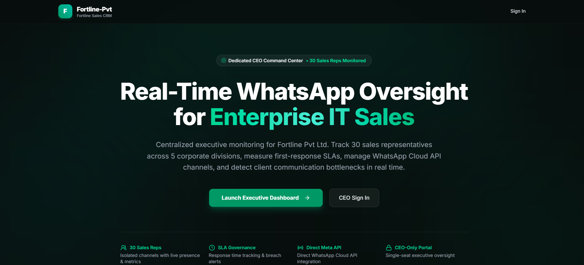

# 🚀 Fortline-Pvt Executive WhatsApp Sales CRM

> A self-hosted executive WhatsApp sales oversight platform developed and customized by **Arte Analytics** for Fortline-Pvt.

Fortline CRM gives management centralized visibility into customer conversations handled by sales representatives while allowing the sales team to continue using their normal WhatsApp applications.

<p align="center">
  
</p>

<p align="center">
  <b>💬 Centralized WhatsApp Oversight</b> •
  <b>👥 Sales Team Monitoring</b> •
  <b>📊 Executive Visibility</b> •
  <b>🔐 Secure Self-Hosted Infrastructure</b>
</p>

---

# 🎯 Purpose

In many businesses, management has limited visibility into how sales representatives communicate with customers.

Fortline CRM is designed to solve this problem by giving the CEO a centralized platform to:

- Monitor customer conversations
- Review sales representative activity
- Track WhatsApp line status
- Maintain accountability
- Review customer communication history
- Reply through the correct sales representative's WhatsApp line
- Monitor customer handling without requiring sales representatives to use a separate CRM account

The sales team continues using WhatsApp normally while the CEO receives centralized oversight from the CRM dashboard.

---

# 👤 Access Model

Fortline CRM is currently designed as an **Executive / CEO-only management platform**.

### CEO

The CEO signs in to the CRM using secure email and password authentication.

The CEO can:

- View connected sales representatives
- Monitor WhatsApp conversations
- Review customer interactions
- Open customer chat histories
- Reply to customers
- Monitor connected WhatsApp lines
- Review dashboard information
- View contacts and conversations
- Link or reconnect sales WhatsApp accounts

### Sales Representatives

Sales representatives do **not** require CRM accounts.

They continue using their normal WhatsApp applications.

Their WhatsApp accounts are connected to the Fortline system through:

- QR Code connection
- Phone Pairing Code

---

# ✨ Core Features

## 💬 Executive WhatsApp Inbox

The centralized inbox allows the CEO to review customer conversations handled by multiple sales representatives.

Features include:

- Centralized conversation monitoring
- Sales representative separation
- Customer chat history
- Incoming messages
- Outgoing messages
- Conversation timestamps
- Correct WhatsApp line routing
- Historical message synchronization
- Customer conversation continuity

Each conversation remains associated with the correct sales representative and WhatsApp channel.

---

## 👥 Sales Team Monitoring

Fortline CRM maintains a centralized sales team directory.

Management can view:

- Sales representative name
- Phone number
- WhatsApp connection status
- Assigned WhatsApp instance
- Connected / disconnected status
- Sales activity
- Customer conversations

Each representative has an isolated WhatsApp connection.

---

# 📱 WhatsApp Connection

Fortline CRM integrates with **Evolution API** using WhatsApp Baileys sessions.

Sales representatives can connect their WhatsApp lines through two separate methods.

## QR Code

A QR code is generated and scanned using WhatsApp:

```text
WhatsApp
→ Linked Devices
→ Link a Device
→ Scan QR Code
```

## Phone Pairing Code

The CRM can also generate a WhatsApp phone pairing code.

```text
Sales Representative Phone Number
        ↓
Evolution API
        ↓
Pairing Code
        ↓
WhatsApp Linked Device
```

The pairing workflow includes lifecycle handling for:

- Existing sessions
- Stale instances
- Instance deletion
- Instance recreation
- Connection readiness
- Pairing-code generation
- Webhook registration

---

# 🖼 WhatsApp Media Support

Fortline CRM supports secure WhatsApp media rendering inside conversations.

Supported media includes:

### Images

- Full-resolution images
- Responsive chat previews
- Loading placeholders
- Full-screen lightbox
- Image captions
- Retry state when full media is unavailable

### Videos

- HTML5 video playback
- Play / Pause
- Seek
- Volume
- Mute
- Fullscreen
- Video poster thumbnails

### Voice Notes / Audio

- Play / Pause
- Seekable progress bar
- Duration
- Volume controls
- WhatsApp-style compact audio player

### Documents

- PDF files
- Word documents
- Excel files
- Other attachments
- File name
- File type
- File size when available
- Open / Download actions

---

# 🔐 Secure Media Proxy

WhatsApp media is **not exposed directly from Evolution API to the browser**.

The architecture is:

```text
CRM Browser
     ↓
Fortline Next.js API
     ↓
Secure Media Proxy
     ↓
Evolution API
     ↓
WhatsApp Media
```

The application retrieves and decrypts media server-side.

Sensitive credentials such as:

```text
EVOLUTION_API_KEY
SUPABASE_SERVICE_ROLE_KEY
GATEWAY_API_KEY
```

are never exposed to the browser.

---

# 🎯 Correct Sales Representative Routing

Fortline CRM supports multiple sales representatives and multiple WhatsApp lines.

Media and messages are always resolved through the correct sales representative channel.

```text
Message
   ↓
Conversation
   ↓
WhatsApp Channel
   ↓
gateway_instance_id
   ↓
Evolution API Instance
   ↓
Customer Media / Message
```

This prevents conversations or media from different sales representatives from being mixed together.

---

# 📇 Contacts & Customer Conversations

The CRM stores and organizes customer communication data.

Features include:

- Customer contacts
- Conversation history
- Phone numbers
- Sales representative association
- WhatsApp channel association
- Message history
- Media messages
- Conversation timestamps

Unknown WhatsApp contacts are displayed using a safe customer-facing label rather than exposing internal WhatsApp identifiers.

---

# 📊 Executive Dashboard

The executive dashboard provides management visibility into the sales operation.

Depending on available CRM data, the dashboard can display:

- Sales representatives
- WhatsApp line status
- Connected lines
- Conversations
- Contacts
- Recent activity
- Sales communication statistics
- Operational alerts

---

# 🔄 WhatsApp Webhooks

Evolution API sends WhatsApp events to:

```text
https://fortlinesales.cloud/api/evolution/webhook
```

The webhook processes supported WhatsApp events such as:

```text
MESSAGES_UPSERT
MESSAGES_UPDATE
SEND_MESSAGE
CONNECTION_UPDATE
```

Incoming and outgoing message metadata is stored so messages and media can be correctly routed later.

---

# 🗄 Database

Fortline CRM uses **Supabase PostgreSQL** for application data.

Core data includes:

```text
Sales Members
WhatsApp Channels
Contacts
Conversations
Messages
Account Data
Activity Data
```

Important Fortline tables include:

```text
fortline_sales_members
fortline_channels
```

Messages preserve channel and representative relationships to maintain correct WhatsApp routing.

---

# 🔑 Authentication

Authentication is handled using **Supabase Auth**.

The current production implementation is designed for authorized executive access.

Features include:

- Email/password authentication
- Secure session handling
- Protected API routes
- Account-level access checks
- Server-side authorization
- Disabled public password-recovery flow
- Restricted administrative access

---

# 🛠 Technology Stack

| Technology | Purpose |
|---|---|
| Next.js 16 | Full-stack application framework |
| React 19 | User interface |
| TypeScript | Type-safe development |
| Tailwind CSS | UI styling |
| Supabase | Database and authentication |
| PostgreSQL | Application / Evolution persistence |
| Evolution API v2.3.7 | WhatsApp connectivity |
| Baileys | WhatsApp device sessions |
| Redis | Evolution API runtime/cache |
| Docker | Production containerization |
| Docker Compose | Container deployment |
| Traefik | Reverse proxy and SSL routing |
| Let's Encrypt | Production HTTPS certificates |
| Hostinger VPS | Production hosting |
| n8n | Available workflow automation infrastructure |

---

# 🏗 Production Architecture

Fortline CRM is self-hosted on a Hostinger VPS.

```text
                    Internet
                       │
                       ▼
              fortlinesales.cloud
                       │
                       ▼
                    Traefik
                       │
                       ▼
               Fortline Next.js CRM
                  fortline_web
                       │
              ┌────────┴────────┐
              ▼                 ▼
          Supabase        Evolution API
                              │
                       evo.fortlinesales.cloud
                              │
                    ┌─────────┴─────────┐
                    ▼                   ▼
                PostgreSQL             Redis
```

---

# 🌍 Production Domains

### CRM

```text
https://fortlinesales.cloud
```

### Evolution API

```text
https://evo.fortlinesales.cloud
```

### Preview / Staging

```text
https://preview.fortlinesales.cloud
```

---

# 🐳 Production Docker Services

The VPS currently runs services including:

```text
fortline_web
evolution_api
evolution_postgres
evolution_redis
traefik-traefik-1
n8n-knoo-n8n-1
```

The Fortline CRM application runs internally on:

```text
Port 3000
```

and is exposed securely through Traefik.

---

# 📦 Local Development

## Requirements

Recommended:

```text
Node.js >= 22
npm
Git
```

Clone the repository:

```bash
git clone https://github.com/MuhammadHuzaifa007/Fortline-Pvt.git
```

Move into the project:

```bash
cd Fortline-Pvt
```

Install dependencies:

```bash
npm install
```

Create your local environment file:

```bash
cp .env.local.example .env.local
```

Start development server:

```bash
npm run dev
```

Application will run on:

```text
http://localhost:3000
```

---

# ✅ Development Verification

Before pushing production changes always run:

```bash
npm run typecheck
```

Then:

```bash
npm run build
```

When required:

```bash
npm test
```

Production changes should not be deployed if TypeScript or production build fails.

---

# 🔑 Important Environment Variables

Production secrets must be stored inside `.env.local`.

Never commit `.env.local` to Git.

Core variables include:

```env
NEXT_PUBLIC_SUPABASE_URL=
NEXT_PUBLIC_SUPABASE_ANON_KEY=
NEXT_PUBLIC_SUPABASE_PUBLISHABLE_KEY=

SUPABASE_SERVICE_ROLE_KEY=

ENCRYPTION_KEY=

NEXT_PUBLIC_SITE_URL=
NEXT_PUBLIC_APP_LOCALE=

EVOLUTION_API_URL=
EVOLUTION_API_KEY=
EVOLUTION_WEBHOOK_URL=

GATEWAY_URL=
GATEWAY_API_KEY=
```

Additional optional application integrations may require other environment variables.

Never expose server-side secrets using `NEXT_PUBLIC_*`.

---

# 🚀 Production Deployment

The production source is maintained in GitHub and deployed manually to the Hostinger VPS.

## 1. Test Locally

```bash
npm run typecheck
npm run build
```

## 2. Commit Changes

```bash
git add .
git commit -m "Update Fortline CRM"
git push origin main
```

## 3. Pull on VPS

```bash
cd /opt/fortline/app
git pull origin main
```

## 4. Build Production Docker Image

```bash
cd /opt/fortline

docker compose \
  --env-file ./app/.env.local \
  -f docker-compose.prod.yml \
  build
```

## 5. Deploy Updated Container

```bash
docker compose \
  --env-file ./app/.env.local \
  -f docker-compose.prod.yml \
  up -d
```

## 6. Verify

```bash
docker ps --filter name=fortline_web
```

```bash
docker logs --tail 50 fortline_web
```

Expected:

```text
Next.js 16.x
✓ Ready
```

Verify production:

```bash
curl -I https://fortlinesales.cloud
```

Expected:

```text
HTTP/2 200
```

---

# ⛔ Temporary CRM Shutdown

To temporarily stop **only the Fortline CRM website**:

```bash
docker stop fortline_web
```

This does not intentionally stop:

```text
Evolution API
PostgreSQL
Redis
Traefik
n8n
```

To start the CRM again:

```bash
docker start fortline_web
```

Verify:

```bash
docker logs --tail 30 fortline_web
```

---

# ⚠ Important Production Rules

Do not run the legacy Evolution gateway compose file for the production Fortline deployment.

Do not unnecessarily run:

```bash
docker compose down
```

against infrastructure containing Evolution services.

Do not manually stop:

```text
evolution_api
evolution_postgres
evolution_redis
traefik-traefik-1
```

during ordinary CRM deployments.

Do not commit:

```text
.env.local
API keys
Supabase service-role keys
Evolution API keys
Passwords
Private SSH keys
```

---

# 🔒 Security

The production system includes security controls such as:

- HTTPS through Let's Encrypt
- Reverse proxy through Traefik
- Server-side Evolution API authentication
- Protected media proxy
- Supabase authentication
- Account-level access validation
- Server-side secret handling
- Isolated WhatsApp instance routing
- Protected application APIs
- No direct browser exposure of Evolution API credentials

---

# 🧪 Production Testing Checklist

After major deployment verify:

```text
✓ CEO login
✓ Dashboard
✓ Sales Team
✓ Contacts
✓ Inbox
✓ Incoming WhatsApp message
✓ Outgoing CRM reply
✓ Correct representative routing
✓ QR connection
✓ Phone pairing code
✓ Image rendering
✓ Full-resolution image lightbox
✓ Video playback
✓ Voice-note playback
✓ Document opening
✓ Media captions
✓ Historical conversation loading
✓ HTTPS
✓ Evolution API connectivity
```

---

# 👨‍💻 Developed & Customized By

## Arte Analytics

Fortline CRM has been developed, customized, integrated, and deployed by **Arte Analytics** as a business-focused WhatsApp sales oversight solution.

Services include:

- AI & Full-Stack Development
- Custom CRM Development
- ERP Solutions
- WhatsApp Automation
- AI Sales Agents
- Business Automation
- API Integration
- Web Development
- Digital Solutions

---

# 🏢 Project

## Fortline-Pvt

Fortline CRM is designed to provide executive management with visibility and accountability across customer-facing WhatsApp sales communication.

---

# 📄 License

This repository contains customized application logic, integrations, deployment configuration, and business-specific enhancements developed for Fortline-Pvt.

Any third-party or upstream components remain subject to their respective licenses.

Custom Fortline-specific business logic and Arte Analytics modifications should not automatically be assumed to be MIT-licensed unless explicitly stated.

---

# 📌 Project Status

```text
Production Hosting       ✅ Hostinger VPS
Docker Deployment        ✅ Active
Traefik Reverse Proxy    ✅ Active
HTTPS / Let's Encrypt    ✅ Active
Supabase                 ✅ Active
Evolution API            ✅ Active
WhatsApp QR Linking      ✅ Active
Phone Pairing            ✅ Active
Executive CRM Inbox      ✅ Active
WhatsApp Media Proxy     ✅ Active
Full Resolution Images   ✅ Implemented
Video Support            ✅ Implemented
Voice Notes              ✅ Implemented
Documents                ✅ Implemented
```

---

<p align="center">
  Built and customized for <b>Fortline-Pvt</b><br>
  Developed by <b>Arte Analytics</b>
</p>
